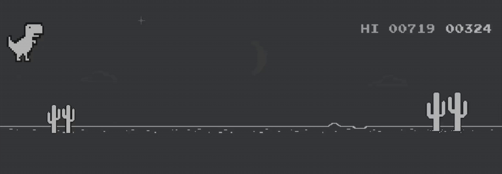

# Hi 👋, I'm Michael Soro

### AI Engineer · AI Security · Founder of AVENZOQ

I build with AI and I secure it. At [AVENZOQ](https://avenzoq.com) I ship AI-powered products and automation, and the tools that keep them safe — MCP, agents and LLM applications.

My edge: I started in offensive security, so I build AI systems the way an attacker would try to break them. I assume the text an agent reads is untrusted, that its tools are powerful, and that trust must be earned.

---

## 🛡️ Featured project — Probe

**Open-source security scanner for MCP servers and AI agents.** It catches prompt injection, tool poisoning, excessive agency and exfiltration paths — before an AI assistant is wired into your databases, Slack or email.

[](https://www.npmjs.com/package/@avenzoq/probe)
[](https://github.com/MaikolSoro/probe)
[](https://github.com/MaikolSoro/probe/blob/main/LICENSE)

```bash
npx @avenzoq/probe config     # audit the MCP servers your AI client has configured
```

> 📊 I ran it across 39 public MCP servers (406 tools): 0 hidden attacks, but 23% can run code and 26% combine private-data access with a way to send it out. [Read the study →](https://github.com/MaikolSoro/probe)

---

## 🔧 Core Focus

- **AI engineering** — LLM apps, agents, MCP servers and tools, automation
- **AI security** — prompt injection, tool poisoning, LLM red-teaming (OWASP LLM Top 10)
- Native iOS (Swift) and Android (Kotlin) development
- Microservices, distributed systems and cloud deployment (AWS, Google Cloud)
- Security-by-design across AI, mobile and backend

## 🧠 How I work

Product mindset: understand user impact, balance delivery speed with long-term maintainability, and reduce technical debt without slowing growth. Security isn't a phase at the end — it's a design constraint from day one.

<br>

## Technologies


[]()
[]()


## Languages


<br>


<br>

## 🔐 Offensive security toolkit


## 👨🏻‍💻 CTF Player

[](https://app.hackthebox.com/profile/776426)
[](https://tryhackme.com/)


<br>

## 🤝 Reach me

<a href="https://avenzoq.com"></a>
[][linkedin]
<a href="mailto:maikolsoro.z1998@gmail.com"></a>
[][twitter]
[][instagram]

<hr>



<hr>

<details>
  <summary>:zap: Most Used Languages</summary>
  
</details>

<details>
  <summary>:zap: GitHub Stats</summary>
  
</details>

<br><p align="center"><b>Visitors Count</b></p>
<p align="center"></p>

<!-- Links -->

[linkedin]: https://www.linkedin.com/in/REEMPLAZA-CON-TU-USUARIO
[twitter]: https://twitter.com/maikol_soro
[instagram]: https://instagram.com/maikol_sz
[facebook]: https://facebook.com/MaikolSoro
[github]: https://github.com/MaikolSoro
